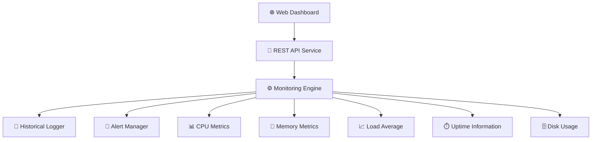
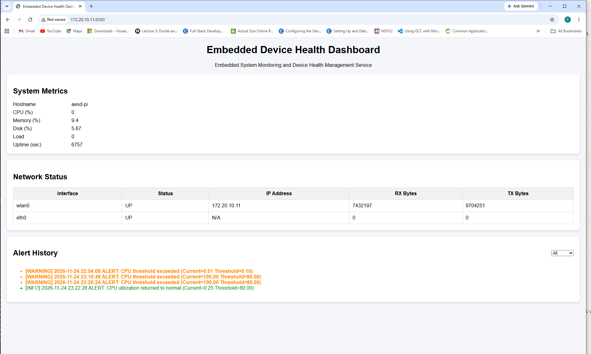
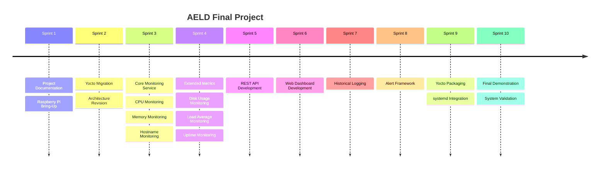

# AESD Final Project

## Embedded System Monitoring and Health Management Service

This repository contains the individual submission for the Advanced Embedded Linux Development (AELD) Final Project.

The project implements a lightweight embedded Linux system monitoring and health management service running on a Raspberry Pi 4 and deployed using the Yocto Project. The service continuously collects operating system health metrics and provides access to system information through a REST API, historical logging subsystem, alert framework, and web-based dashboard while demonstrating concepts covered throughout the AELD course.

---

## Project Overview

Project documentation and planning information are available in the GitHub Wiki:

[Project Overview](https://github.com/patricereneeemery/aeld-final-project/wiki/Project-Overview)

The Embedded System Monitoring and Health Management Service continuously monitors Linux system health information including:

- CPU utilization
- Memory utilization
- Disk utilization
- Load average
- System uptime
- Hostname information

Collected metrics are:

- Exposed through a REST API
- Logged for historical analysis
- Evaluated against configurable alert thresholds
- Displayed through a web-based monitoring dashboard

The project primarily utilizes ANSI C and POSIX/Linux APIs for low-level operating system interaction while incorporating C++17 and selected STL containers where they improve maintainability, concurrency, data management, and software architecture.

---

## Source Code Organization

### Build System Repository

Build system and application development repository:

[GitHub Repository](https://github.com/patricereneeemery/aeld-final-project)

This repository contains:

- Yocto integration
- Application source code
- Project documentation
- Sprint planning artifacts
- systemd service definitions
- Testing artifacts
- Deployment configuration

### Additional Repositories

No additional repositories are currently planned.

All project source code, build system configuration, documentation, testing artifacts, and deployment files will be maintained in a single repository.

---

## Documentation

Project documentation is maintained in the `docs` directory.

- `docs/project-overview.md`
- `docs/software-architecture.md`
- `docs/design-document.md`
- `docs/requirements.md`
- `docs/project-schedule.md`
- `docs/Dashboard.png`

---

## Repository Structure

```text
aeld-final-project/
|
├── .github/workflows
├── docs
│   ├── project-overview.md
│   ├── software-architecture.md
│   ├── design-document.md
│   ├── requirements.md
│   └── project-schedule.md
│
├── src
│   ├── main.cpp
│   ├── metrics.c
│   ├── metrics.h
│   ├── monitor.cpp
│   ├── logger.cpp
│   └── alert_manager.cpp
│
├── web
│   ├── index.html
│   ├── dashboard.js
│   └── dashboard.css
│
├── yocto
├── systemd
├── tests
└── README.md
```

---

## Project Architecture



---
## Dashboard

The dashboard provides real-time monitoring of:

- CPU Utilization
- Memory Utilization
- Disk Utilization
- System Load
- Uptime
- Network Status
- Alert History

### Dashboard Screenshot



## Project Roadmap



---

## Hardware Platform

### Primary Hardware

- Raspberry Pi 4 Model B

### Deployment Platform

- Embedded Linux
- Yocto Project

---

## Technologies

- Raspberry Pi 4
- Yocto Project
- Linux
- ANSI C
- C++17
- STL Containers
- POSIX APIs
- REST API
- HTTP Networking
- JSON
- Git

---

## Primary Features

- CPU Monitoring
- Memory Monitoring
- Disk Usage Monitoring
- Load Average Monitoring
- Uptime Monitoring
- Hostname Monitoring
- Historical Logging
- Alert Generation
- REST API Interface
- Web Dashboard

---

## Current Status

### Sprint 1 and Sprint 2

Completed Work:

- Repository created
- Raspberry Pi configured
- SSH access established
- Project overview completed
- Initial project architecture defined
- Yocto migration completed
- Sprint planning updated

### Current Focus

#### Issue 6 - Core Monitoring Service

- CPU utilization monitoring
- Memory utilization monitoring
- Hostname monitoring

#### Issue 7 - Extended Metrics Collection

- Disk utilization monitoring
- Load average monitoring
- Uptime monitoring

---

## Student

### Patrice Renee Emery

Roles:

- Architecture
- Development
- Testing
- Documentation
- Deployment
- Sprint Planning

---

## Planned Demonstration

The final demonstration will include:

- Yocto-based deployment
- Automatic service startup
- Real-time metric collection
- REST API operation
- Web dashboard operation
- Historical logging
- Alert generation
- System validation testing

---

## Build

Build instructions will be added during the Yocto integration phase.

---

## Run

Runtime instructions will be added during application implementation and testing.
