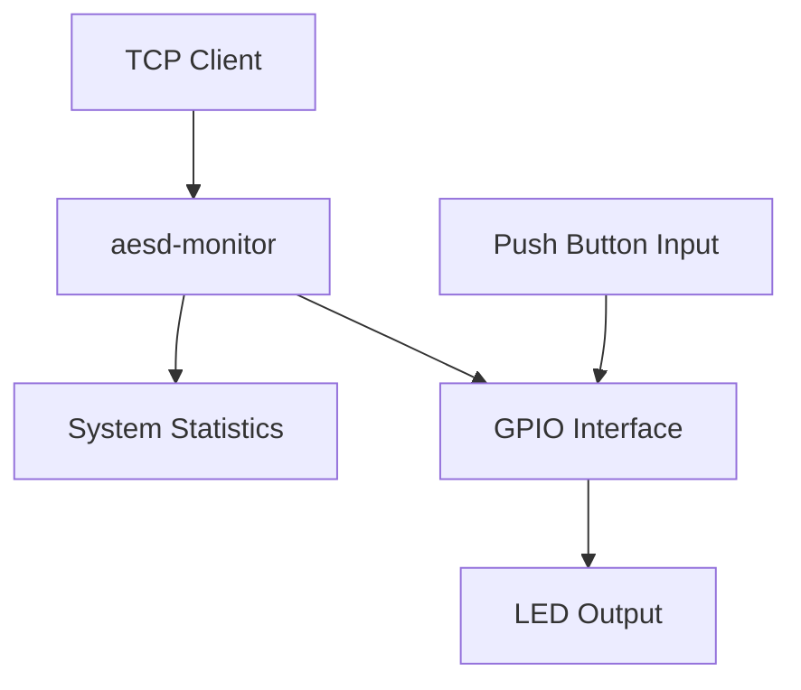
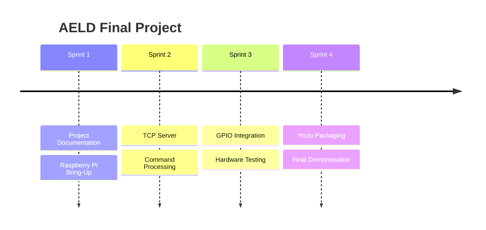

# AESD Final Project

## Raspberry Pi Monitoring and Control Service

This repository contains the individual submission for the Advanced Embedded Linux Development (AELD) Final Project.

The project implements a lightweight embedded Linux monitoring and control service running on a Raspberry Pi 4. The service provides TCP-based access to system status information and GPIO hardware interfaces while demonstrating concepts covered throughout the AELD course.

---

## Project Overview

Project documentation and planning information are available in the GitHub Wiki:

https://github.com/patricereneeemery/aeld-final-project/wiki/Project-Overview

---

## Source Code Organization


### Build System Repository

Build system and application development repository:

https://github.com/patricereneeemery/aeld-final-project

This repository contains:

- Yocto integration
- Application source code
- Project documentation
- Sprint planning artifacts
- systemd service definitions
- Testing artifacts

### Additional Repositories

No additional repositories are currently planned.

All project source code, build system configuration, documentation, testing artifacts, and deployment files will be maintained in a single repository.

---

## Documentation

Project documentation is maintained in the `docs` directory.

- `docs/project-overview.md`
- `docs/project-proposal.md`
- `docs/architecture.md`
- `docs/sprint-plan.md`
- `docs/schedule.md`

---

## Repository Structure

```text
aeld-final-project/
|
├── .github/workflows
├── docs
├── applications
│   └── aesd-monitor
├── yocto
├── systemd
├── scripts
├── tests
└── README.md
```

---

## Project Architecture



---

## Project Roadmap



---

## Hardware Platform

### Primary Hardware

- Raspberry Pi 4 Model B

### Peripheral Hardware

- Breadboard
- LEDs
- Push Button
- Resistors
- Jumper Wires

---

## Current Status

**Sprint 1 - Planning and Platform Bring-Up**

Completed work:

- Repository created
- Raspberry Pi configured
- SSH access established
- Project overview completed
- Initial project architecture defined

Current focus:

- TCP server prototype
- Application skeleton implementation

---

## Student

### Patrice Renee Emery

Roles:

- Architecture
- Development
- Testing
- Documentation
- Deployment
- Sprint Planning

---

## Build

Build instructions will be added during Sprint 2.

---

## Run

Runtime instructions will be added during Sprint 3.
