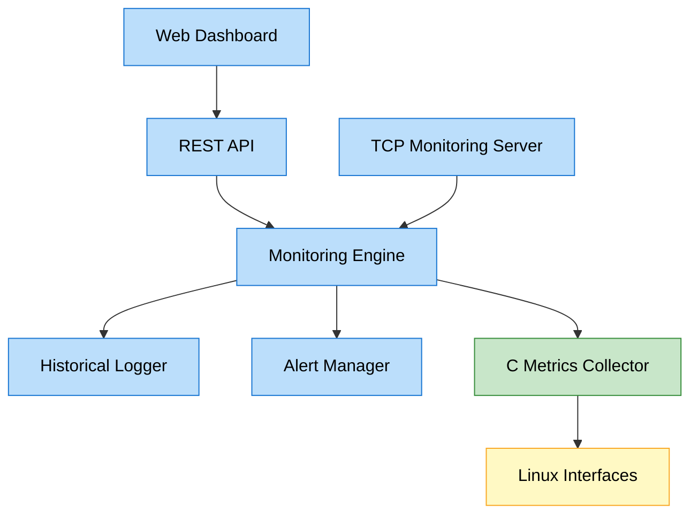
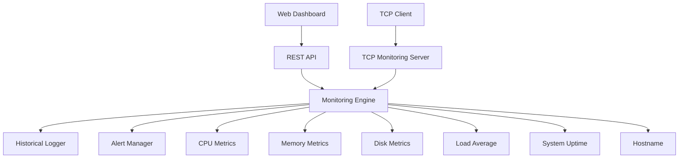
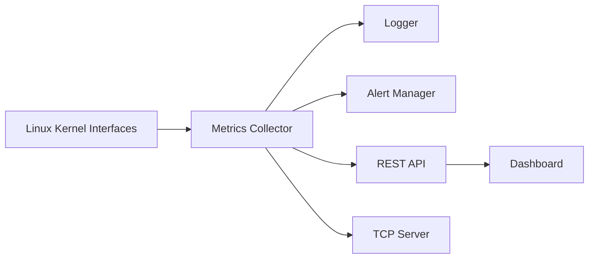
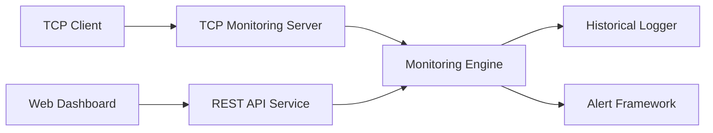

# Software Architecture

## Architecture Overview

The Embedded System Monitoring and Health Management Service follows a layered software architecture designed to separate networking, monitoring, logging, alerting, and presentation concerns.

The architecture emphasizes Linux systems programming, TCP networking, process monitoring, and embedded software engineering practices while maintaining deployment compatibility with the Yocto Project.

The application primarily uses ANSI C and POSIX APIs for Linux interaction and utilizes C++17 and STL components where appropriate to improve maintainability and software organization.

---
## C/C++ Software Architecture Strategy

The Embedded System Monitoring and Device Health Management Service follows a hybrid C and C++ architecture that combines traditional embedded Linux systems programming with modern software engineering practices.

The application separates low-level operating system interaction from higher-level service orchestration and management responsibilities.

This architectural approach provides efficient access to Linux kernel interfaces while maintaining modularity, maintainability, and extensibility.

---

### ANSI C Layer

ANSI C is used for direct interaction with Linux operating system facilities and low-level monitoring functions.

Primary responsibilities include:

- procfs access
- POSIX interfaces
- Socket interfaces
- Hostname collection
- Resource collection
- Linux system interaction

Key Linux interfaces include:

```text
/proc/stat
/proc/meminfo
/proc/loadavg
/proc/uptime
statvfs()
gethostname()
```

These components form the foundation of the metrics collection subsystem.

---

### C++17 Service Layer

C++17 is used for higher-level application services and overall system coordination.

Primary responsibilities include:

- Monitoring Engine
- TCP Server Management
- Logging Framework
- Alert Processing
- REST API Services
- Dashboard Integration
- Thread Coordination
- Application Lifecycle Management

C++ provides improved software organization while preserving performance suitable for embedded Linux environments.

---

### STL Integration

Selected STL components may be incorporated where they provide meaningful architectural benefits.

Potential examples include:

```cpp
std::vector
std::string
std::map
std::thread
std::mutex
std::chrono
std::unique_ptr
```

These features improve:

- Resource management
- Data organization
- Concurrency handling
- Software maintainability

---

### Architectural Philosophy

The project follows the principle:

```text
C for Linux interaction

C++ for service architecture
```

This approach allows the project to leverage the strengths of both languages while avoiding unnecessary complexity.

The resulting architecture reflects common design patterns used in modern embedded Linux products where low-level hardware and operating system interfaces remain implemented in C while higher-level services and application logic are implemented using modern C++.

## Language Layer Architecture



## High-Level Architecture



---

## Major Components

### TCP Monitoring Server

Provides a network-accessible monitoring interface for remote clients.

Responsibilities:

- Accept incoming TCP connections
- Process monitoring requests
- Return requested system information
- Manage client communications

---

### Monitoring Engine

Coordinates all system monitoring activities.

Responsibilities:

- Collect system metrics
- Schedule monitoring tasks
- Manage subsystem interactions
- Distribute collected information

---

### Metrics Collection Layer

Collects operating system health information.

Linux Interfaces:

- `/proc/stat`
- `/proc/meminfo`
- `/proc/loadavg`
- `/proc/uptime`
- `gethostname()`
- `statvfs()`

---

### Historical Logger

Stores collected monitoring information.

Responsibilities:

- Historical record retention
- Event logging
- Alert logging
- Performance history

---

### Alert Manager

Evaluates system health conditions.

Responsibilities:

- Threshold evaluation
- Warning generation
- Critical alert generation
- Event notification

---

### REST API

Provides HTTP access to monitoring information.

Example Endpoints:

```text
/api/system
/api/cpu
/api/memory
/api/disk
/api/load
/api/uptime
```

---

### Web Dashboard

Provides browser-based monitoring visibility.

Responsibilities:

- Metric visualization
- Status presentation
- System overview
- Alert visibility

---

## Data Flow



---

## Technology Strategy

### ANSI C

Used for:

- Linux system interaction
- POSIX interfaces
- Metrics collection
- Resource access

### C++17

Used for:

- Application orchestration
- Data management
- Service organization
- Concurrency management

### STL Components

Potential STL usage:

```cpp
std::vector
std::string
std::map
std::thread
std::mutex
std::chrono
```
# *** Architecture Updates ***
# Software Architecture

## High Level Architecture



---

## Monitoring Subsystem

The monitoring subsystem is responsible for collecting:

### Host Metrics

- CPU Utilization
- Memory Utilization
- Disk Utilization
- Load Average
- System Uptime
- Hostname Information

### Network Metrics

- Interface Status
- IP Address Information
- Connectivity Status
- RX Traffic Statistics
- TX Traffic Statistics

---

## Logging Subsystem

The logging subsystem records:

- Historical Metrics
- Alert Events
- Recovery Events

Files:

```text
aesd-monitor.log
aesd-alerts.log
```

---

## Alert Subsystem

The alert framework evaluates:

### Host Thresholds

- CPU Threshold
- Memory Threshold
- Disk Threshold

### Network Events

- Interface Down
- Connectivity Loss
- Connectivity Restored
- IP Address Changes

---

## Communication Layers

### TCP Service

Port:

```text
9000
```

Provides:

```text
GET_CPU
GET_MEMORY
GET_DISK
GET_LOAD
GET_UPTIME
GET_STATUS
GET_NETWORK
```

### REST API

Port:

```text
8080
```

Provides:

```text
/api/system
/api/cpu
/api/memory
/api/disk
/api/load
/api/uptime
/api/alerts
```

### Dashboard

Browser-based visualization platform.
