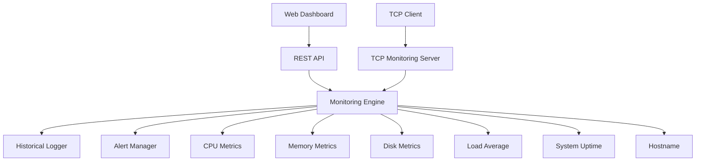
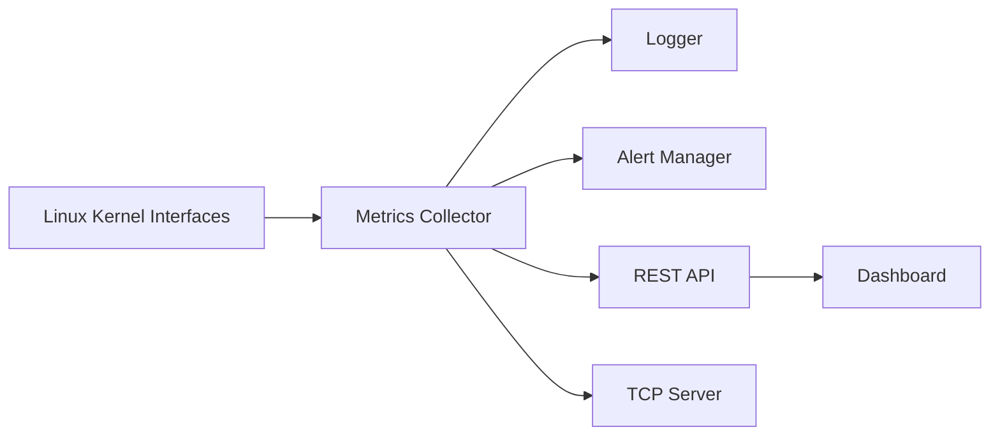

# Software Architecture

## Architecture Overview

The Embedded System Monitoring and Health Management Service follows a layered software architecture designed to separate networking, monitoring, logging, alerting, and presentation concerns.

The architecture emphasizes Linux systems programming, TCP networking, process monitoring, and embedded software engineering practices while maintaining deployment compatibility with the Yocto Project.

The application primarily uses ANSI C and POSIX APIs for Linux interaction and utilizes C++17 and STL components where appropriate to improve maintainability and software organization.

---

## High-Level Architecture



---

## Major Components

### TCP Monitoring Server

Provides a network-accessible monitoring interface for remote clients.

Responsibilities:

- Accept incoming TCP connections
- Process monitoring requests
- Return requested system information
- Manage client communications

---

### Monitoring Engine

Coordinates all system monitoring activities.

Responsibilities:

- Collect system metrics
- Schedule monitoring tasks
- Manage subsystem interactions
- Distribute collected information

---

### Metrics Collection Layer

Collects operating system health information.

Linux Interfaces:

- `/proc/stat`
- `/proc/meminfo`
- `/proc/loadavg`
- `/proc/uptime`
- `gethostname()`
- `statvfs()`

---

### Historical Logger

Stores collected monitoring information.

Responsibilities:

- Historical record retention
- Event logging
- Alert logging
- Performance history

---

### Alert Manager

Evaluates system health conditions.

Responsibilities:

- Threshold evaluation
- Warning generation
- Critical alert generation
- Event notification

---

### REST API

Provides HTTP access to monitoring information.

Example Endpoints:

```text
/api/system
/api/cpu
/api/memory
/api/disk
/api/load
/api/uptime
```

---

### Web Dashboard

Provides browser-based monitoring visibility.

Responsibilities:

- Metric visualization
- Status presentation
- System overview
- Alert visibility

---

## Data Flow



---

## Technology Strategy

### ANSI C

Used for:

- Linux system interaction
- POSIX interfaces
- Metrics collection
- Resource access

### C++17

Used for:

- Application orchestration
- Data management
- Service organization
- Concurrency management

### STL Components

Potential STL usage:

```cpp
std::vector
std::string
std::map
std::thread
std::mutex
std::chrono
```
