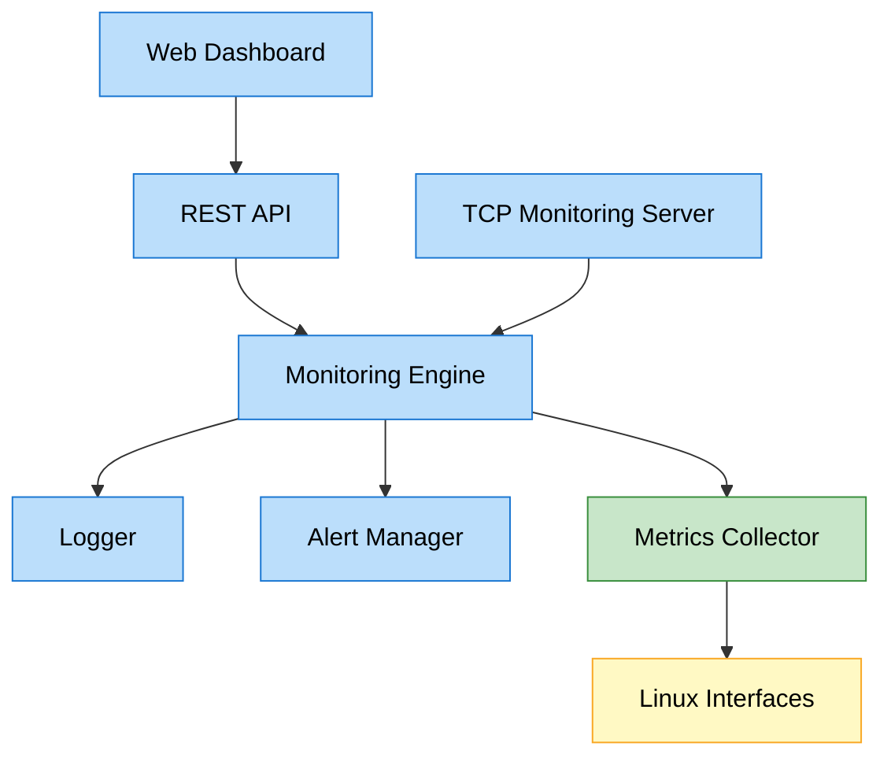
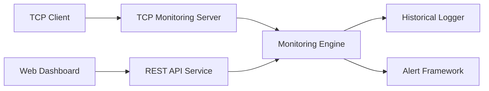
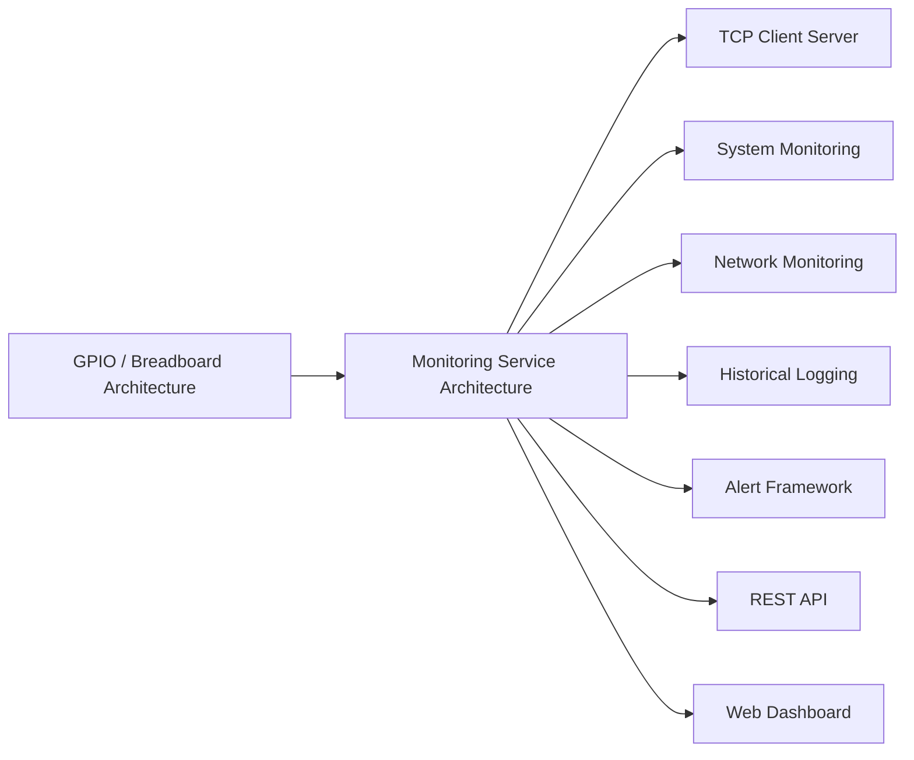

# Project Overview

## Project Title

Embedded System Monitoring and Device Health Management Service

---

## Project Summary

The Embedded System Monitoring and Device Health Management Service is a lightweight embedded Linux application deployed on a Raspberry Pi 4 using the Yocto Project.

The application combines TCP client/server networking, Linux systems programming, multithreaded monitoring services, historical logging, alert generation, REST API services, and dashboard visualization to provide real-time and historical visibility into embedded platform health and operating system status.

The monitoring engine continuously collects system and network health information through Linux operating system interfaces.

Collected information includes:

- CPU Utilization
- Memory Utilization
- Disk Utilization
- Load Average
- System Uptime
- Hostname Information
- Network Interface Status
- IP Address Information
- Network Connectivity Status
- Network Traffic Statistics

Collected metrics are exposed through multiple software interfaces including:

- TCP Client/Server Communications
- Historical Logging
- Alert Notifications
- REST API Services
- Web Dashboard Visualization

The resulting platform provides a practical foundation for embedded device health management, monitoring, troubleshooting, validation, and operational awareness.

The project demonstrates advanced embedded Linux software engineering concepts including:

- Linux Systems Programming
- POSIX APIs
- Socket Programming
- TCP/IP Networking
- REST API Design
- Multithreaded Programming
- Historical Data Collection
- Alert Processing
- Service Integration
- Yocto-Based Deployment
- Embedded Device Health Management

---

# C/C++ Software Architecture Strategy

The Embedded System Monitoring and Device Health Management Service follows a hybrid C and C++ architecture intended to balance traditional embedded Linux development practices with modern software engineering techniques.

Rather than implementing the entire application in either language, each language is utilized where it provides the greatest benefit.

---

## ANSI C Responsibilities

ANSI C is utilized for direct Linux operating system interaction and low-level monitoring functionality.

Examples include:

- procfs access
- POSIX system calls
- Socket interfaces
- File I/O
- Data collection
- Linux integration

Example interfaces include:

```text
/proc/stat
/proc/meminfo
/proc/loadavg
/proc/uptime
/proc/net/dev

statvfs()
gethostname()
getifaddrs()
```

The use of C aligns with traditional embedded Linux development practices and provides efficient access to operating system facilities.

---

## C++17 Responsibilities

C++17 is utilized for higher-level application services and software organization.

Examples include:

- Monitoring engine orchestration
- Service integration
- Historical logging
- Alert management
- Network monitoring orchestration
- REST API implementation
- Dashboard integration
- Thread management
- Data management
- Resource coordination

C++17 improves maintainability while preserving performance characteristics appropriate for embedded systems.

---

## STL Utilization

Selected Standard Template Library (STL) components may be utilized where they provide meaningful architectural advantages.

Potential examples include:

```cpp
std::vector
std::string
std::map
std::thread
std::mutex
std::chrono
std::unique_ptr
```

These components support safer resource management and improved software organization.

---

## Architectural Philosophy

The project intentionally follows a:

```text
C for Linux Interaction

C++ for Application Architecture
```

development model.

This approach combines traditional embedded Linux programming techniques with modern software engineering practices.

---

# Language Layer Architecture



---

# Runtime Service Architecture



---

# Problem Statement

Embedded Linux systems frequently operate unattended and provide limited visibility into processor utilization, memory consumption, storage utilization, network status, and overall platform health.

Developers and administrators require access to performance information to support validation, troubleshooting, maintenance, and operational awareness.

Many lightweight embedded platforms provide limited monitoring capabilities and often require direct device access to retrieve meaningful status information.

This project addresses these challenges through the development of a network-accessible monitoring service capable of providing both real-time and historical platform visibility.

---

# Project Pivot

## Original Architecture

The original project concept focused on GPIO monitoring and control using breadboard-based external hardware.

Examples included:

- LEDs
- Push Buttons
- Resistors
- Breadboard Circuitry
- GPIO Interfaces

The original architecture emphasized hardware interaction and external device control.

---

## Revised Architecture

During Sprint 2 implementation, hardware integration complexity significantly increased project risk and reduced development efficiency.

To improve project success and increase alignment with Advanced Embedded Linux Development learning objectives, the project architecture was revised.

The revised architecture maintains:

- Raspberry Pi 4 Platform
- Yocto Deployment Environment
- Linux Systems Programming
- Embedded Networking
- Service Deployment
- System Monitoring

while replacing breadboard-dependent functionality with software-driven monitoring capabilities.

The revised architecture emphasizes:

- TCP Client/Server Communications
- Linux System Monitoring
- Network Monitoring
- Historical Logging
- Alert Framework
- REST API Services
- Web Dashboard Visualization

This revision reduces hardware dependency while increasing focus on software architecture, Linux interaction, networking, service development, and embedded systems engineering.

---

# Project Pivot Visualization



---

# Project Objectives

## Networking Objectives

- Implement a TCP monitoring server
- Implement TCP client/server communications
- Process remote monitoring requests
- Return requested monitoring information

---

## Monitoring Objectives

- Monitor CPU utilization
- Monitor memory utilization
- Monitor disk utilization
- Monitor load average
- Monitor system uptime
- Monitor hostname information
- Monitor network interface status
- Monitor IP address information
- Monitor network connectivity
- Monitor network traffic statistics

---

## Service Objectives

- Maintain historical records
- Generate threshold-based alerts
- Generate network alerts
- Generate recovery notifications
- Provide REST API access
- Provide dashboard visualization

---

## Deployment Objectives

- Package application through Yocto
- Deploy as a systemd service
- Support automatic startup during boot

---

# System Capabilities

The monitoring engine continuously collects:

- CPU Utilization
- Memory Utilization
- Disk Utilization
- Load Average
- System Uptime
- Hostname Information
- Network Interface Status
- IP Address Information
- Network Connectivity Status
- RX Traffic Statistics
- TX Traffic Statistics

---

## TCP Monitoring Interface

Remote clients may connect to the monitoring server and request monitoring data.

Example requests include:

```text
GET_CPU
GET_MEMORY
GET_DISK
GET_LOAD
GET_UPTIME
GET_STATUS
```

---

## Historical Logging

The application maintains historical records for:

- Performance Analysis
- Validation
- Troubleshooting
- Operational Review
- Alert Correlation

---

## Alert Processing

Collected metrics are evaluated against configurable thresholds to generate:

- Informational Alerts
- Warning Alerts
- Critical Alerts
- Recovery Notifications

---

## REST API Services

System information is exposed through lightweight JSON endpoints.

Example endpoints:

```text
/api/system
/api/cpu
/api/memory
/api/disk
/api/load
/api/uptime
/api/alerts
```

---

## Dashboard Interface

A browser-accessible dashboard provides visualization of:

- CPU Utilization
- Memory Utilization
- Disk Utilization
- Load Average
- Uptime
- Hostname
- Network Status
- Active Alerts

---

# Network Monitoring Capabilities

Sprint 3 introduces dedicated network monitoring functionality.

Collected information includes:

- Interface Status
- IP Address Information
- Connectivity Status
- RX Byte Statistics
- TX Byte Statistics

Network health information is integrated into:

- Historical Logging
- Alert Generation
- REST API Services
- Dashboard Visualization

This functionality extends the project beyond host monitoring and provides visibility into communication subsystem health.

---

# Expected Deliverables

## Software Deliverables

- TCP Monitoring Server
- Monitoring Engine
- Network Monitoring Module
- Metrics Collection Framework
- Historical Logging Framework
- Alert Framework
- REST API
- Web Dashboard

---

## Deployment Deliverables

- Yocto Integration
- Application Package
- systemd Service
- Automated Startup Configuration

---

## Documentation Deliverables

- README
- Project Overview
- Software Architecture
- Design Document
- Requirements Specification
- Project Schedule
- Final Demonstration Material

---

# Sprint Structure

## Sprint 1

Completed

- Documentation
- Project Planning
- Architecture Definition
- Raspberry Pi Bring-Up
- Repository Setup

---

## Sprint 2

Completed

- Project Pivot
- TCP Monitoring Server
- CPU Monitoring
- Memory Monitoring
- Disk Monitoring
- Hostname Monitoring
- Historical Logging
- Alert Framework

---

## Sprint 3

Current Sprint

### Issue #14

Network Monitoring and Connectivity Alerts

### Issue #10

REST API Integration

### Issue #11

Web Dashboard Development

### Additional Activities

- Yocto Integration
- Testing
- Validation
- Final Demonstration Preparation

---

# Success Criteria

The project will be considered successful when:

- TCP client/server communication operates correctly
- System metrics are collected accurately
- Network metrics are collected accurately
- Historical records are maintained successfully
- Alert generation functions correctly
- Recovery notifications function correctly
- REST API endpoints operate correctly
- Dashboard displays system information correctly
- Application deploys through Yocto
- Service starts automatically through systemd
- Final demonstration objectives are satisfied

---

# Software Engineering Objectives

- Utilize ANSI C for Linux operating system interaction
- Utilize C++17 for application architecture
- Utilize STL containers where appropriate
- Implement multithreaded services
- Demonstrate modular software design
- Maintain efficient resource utilization

---

# Final Demo Objectives

The final demonstration will showcase:

- Raspberry Pi Deployment
- Yocto Integration
- Automatic Service Startup
- TCP Client/Server Communication
- Real-Time Metric Collection
- Network Monitoring
- Historical Logging
- Alert Generation
- Recovery Detection
- REST API Functionality
- Web Dashboard Visualization
- Complete End-to-End System Operation

---

# Student

## Patrice Renee Emery

Responsibilities:

- Architecture
- Development
- Testing
- Documentation
- Deployment
- Sprint Planning
- System Integration
