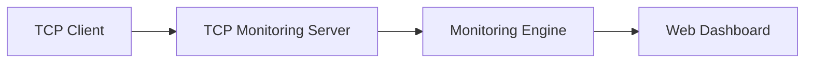
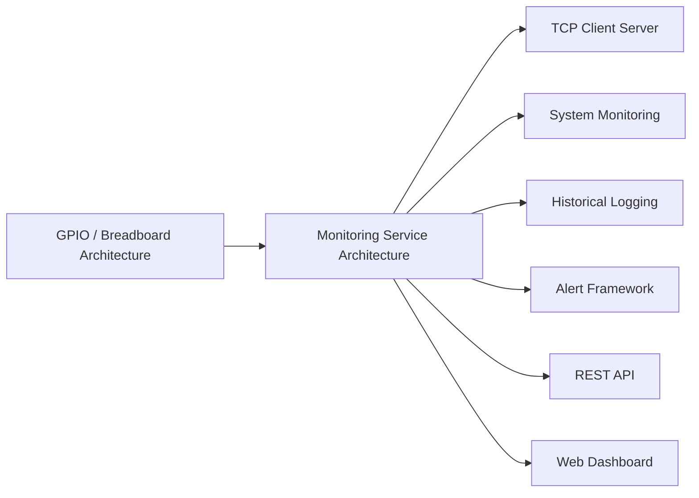

# Project Overview

## Project Title

Embedded System Monitoring and Device Health Management Service

---

## Project Summary

The Embedded System Monitoring and Device Health Management Service is a lightweight embedded Linux application deployed on a Raspberry Pi 4 using the Yocto Project.

The application combines TCP client/server networking, Linux systems programming, and device health monitoring to provide real-time visibility into platform health, resource utilization, and operating system status.

The system continuously collects CPU utilization, memory utilization, disk utilization, load average, uptime, hostname information, and additional operating system metrics through Linux system interfaces.

Collected metrics are made available through multiple software interfaces including:

- TCP Client/Server Communications
- REST API Services
- Historical Logging
- Alert Notifications
- Web Dashboard Visualization

The project demonstrates practical embedded Linux software engineering concepts including:

- Linux Systems Programming
- Socket Programming
- TCP/IP Networking
- Multithreaded Application Design
- Process Monitoring
- Service Integration
- Yocto Deployment
- Device Health Management

The software follows a hybrid development approach utilizing ANSI C and POSIX APIs for low-level Linux system interaction while incorporating modern C++17 language features and selected STL components where they improve software organization, resource management, maintainability, concurrency, and overall system architecture.

C language components are utilized for direct operating system interaction including procfs access, POSIX interfaces, socket operations, and resource collection. C++17 components are utilized for application orchestration, monitoring services, logging, data management, multithreading, and higher-level application logic.

The resulting system demonstrates both traditional embedded Linux systems programming techniques and modern C++ software engineering practices within a deployable Yocto-based embedded platform.

---

## System Overview



---

## Problem Statement

Embedded Linux devices frequently operate unattended and provide limited visibility into processor utilization, memory consumption, storage utilization, and overall platform health.

System administrators and developers require access to performance information in order to support validation, troubleshooting, maintenance, and operational awareness.

Many lightweight embedded systems provide limited monitoring capabilities and often require direct device access to retrieve meaningful status information.

This project addresses these challenges through the development of a network-accessible monitoring service capable of providing both real-time and historical performance visibility.

---

## Project Pivot

### Original Architecture

The original project concept focused on GPIO monitoring and control through external breadboard hardware including:

- LEDs
- Push Buttons
- Resistors
- Breadboard Circuitry
- GPIO Interfaces

The original architecture emphasized hardware interaction and external device control.

### Revised Architecture

During Sprint 2 implementation, practical hardware integration challenges significantly increased project risk and reduced development efficiency.

To improve project success and increase alignment with Advanced Embedded Linux Development learning objectives, the project architecture was revised.

The revised solution maintains:

- Raspberry Pi 4 Platform
- Yocto Deployment Environment
- Linux Systems Programming
- Embedded Networking
- Service Deployment
- System Monitoring

while replacing breadboard-dependent functionality with software-focused monitoring capabilities.

The new architecture emphasizes:

- TCP Client/Server Communications
- Linux System Monitoring
- Historical Logging
- Alert Framework
- REST API Services
- Web Dashboard Visualization

This architectural revision reduces hardware dependency while increasing focus on operating system interaction, networking, software architecture, service management, and embedded Linux development.

---

## Project Pivot Visualization



---

## Project Objectives

### Networking Objectives

- Implement a TCP monitoring server
- Implement TCP client/server communications
- Process remote monitoring requests
- Return requested monitoring information

### Monitoring Objectives

- Monitor CPU utilization
- Monitor memory utilization
- Monitor disk utilization
- Monitor load average
- Monitor system uptime
- Monitor hostname information

### Service Objectives

- Maintain historical records
- Generate threshold-based alerts
- Provide REST API access
- Provide dashboard visualization

### Deployment Objectives

- Package application through Yocto
- Deploy as a systemd service
- Support automatic startup during boot

---

## System Capabilities

### TCP Monitoring Interface

Remote clients will be able to connect to the monitoring server and request health information.

Example requests may include:

```text
GET_CPU
GET_MEMORY
GET_DISK
GET_LOAD
GET_STATUS
```

### Operating System Monitoring

The monitoring engine will continuously collect:

- CPU Utilization
- Memory Utilization
- Disk Utilization
- Load Average
- System Uptime
- Hostname Information

### Historical Logging

The application will maintain historical records for:

- Performance analysis
- Validation
- Troubleshooting
- Alert review

### Alert Processing

Collected metrics will be evaluated against configurable thresholds to generate:

- Informational Alerts
- Warning Alerts
- Critical Alerts

### REST Services

System information will be exposed through lightweight JSON endpoints.

### Dashboard Interface

A browser-accessible dashboard will display current platform status and operating system health information.

---

## Expected Deliverables

### Software Deliverables

- TCP Monitoring Server
- Monitoring Engine
- Metrics Collection Framework
- Historical Logging Subsystem
- Alert Framework
- REST API
- Web Dashboard

### Deployment Deliverables

- Yocto Integration
- Application Package
- systemd Service
- Automated Startup Configuration

### Documentation Deliverables

- README
- Project Overview
- Software Architecture
- Design Document
- Requirements Specification
- Project Schedule
- Final Demonstration Material

---

## Sprint Structure

### Sprint 1

Completed

- Documentation
- Project Planning
- Architecture Definition
- Raspberry Pi Bring-Up
- Repository Setup

### Sprint 2

Current Sprint

- Project Pivot
- TCP Monitoring Server
- CPU Monitoring
- Memory Monitoring
- Hostname Monitoring
- Logging Framework
- Alert Framework

### Sprint 3

Final Sprint

- REST API
- Dashboard
- Yocto Integration
- Testing
- Validation
- Final Demonstration

---

## Success Criteria

The project will be considered successful when:

- TCP client/server communication operates correctly
- System metrics are collected accurately
- Historical records are maintained successfully
- Alert generation functions correctly
- REST API endpoints operate correctly
- Dashboard displays system information correctly
- Application deploys through Yocto
- Service starts automatically through systemd
- Final demonstration objectives are satisfied

---

## Final Demonstration Objectives

The final demonstration will showcase:

- Raspberry Pi deployment
- Yocto integration
- Automatic service startup
- TCP client/server communication
- Real-time metric collection
- Historical logging
- Alert generation
- REST API functionality
- Web dashboard visualization
- Complete end-to-end system operation

---

## Student

### Patrice Renee Emery

Responsibilities:

- Architecture
- Development
- Testing
- Documentation
- Deployment
- Sprint Planning
- System Integration
