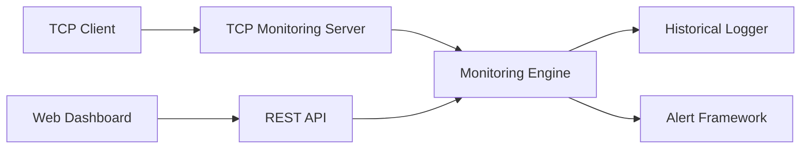

# Project Proposal

## Project Name

### Embedded System Monitoring and Device Health Management Service

---

# Objective

Develop a network-accessible monitoring and device health management platform running on a Raspberry Pi 4 using a custom Yocto-generated Linux image.

The project will demonstrate embedded Linux systems programming, network communications, multithreaded application design, monitoring services, historical logging, alert generation, REST API integration, web-based visualization, automated service deployment, and device health monitoring within a unified embedded Linux platform.

---

# Background

Embedded Linux devices frequently operate in unattended environments and require visibility into system health, operating system status, network connectivity, and resource utilization.

Developers and administrators often require access to monitoring information to support troubleshooting, validation, maintenance, and operational awareness.

Many lightweight embedded systems provide limited monitoring capabilities and require direct system access to retrieve useful diagnostic information.

This project addresses these challenges through the development of a lightweight monitoring platform capable of collecting, processing, logging, and presenting device health data through multiple access mechanisms.

---

# Project Goals

The project will:

- Build a custom Yocto Linux image
- Deploy software to Raspberry Pi 4 hardware
- Implement a monitoring engine
- Collect system health metrics
- Collect network health metrics
- Provide TCP-based monitoring services
- Maintain historical monitoring records
- Generate alert notifications
- Generate recovery notifications
- Expose monitoring information through a REST API
- Visualize system health through a web dashboard
- Integrate with systemd
- Demonstrate concepts learned throughout AELD coursework

---

# Hardware

## Primary Hardware

- Raspberry Pi 4 Model B

## Supporting Hardware

- WiFi Network Interface
- Ethernet Network Interface
- SD Card Storage

All hardware will be supplied by the project author.

---

# Software Components

## aesd-monitor

Primary application providing:

- Monitoring Engine
- TCP Monitoring Service
- Historical Logging
- Alert Framework
- Network Monitoring
- REST API Services
- Dashboard Integration

---

## Monitoring Subsystem

Collects:

### System Metrics

- CPU Utilization
- Memory Utilization
- Disk Utilization
- Load Average
- System Uptime
- Hostname Information

### Network Metrics

- Interface Status
- IP Address Information
- Connectivity Status
- RX Traffic Statistics
- TX Traffic Statistics

---

## Logging Framework

Provides:

- Historical Monitoring Records
- Alert Event Logging
- Recovery Event Logging
- Timestamped Monitoring Data

---

## Alert Framework

Provides:

- CPU Threshold Alerts
- Memory Threshold Alerts
- Disk Threshold Alerts
- Network Alerts
- Recovery Notifications
- Alert Suppression

---

## TCP Monitoring Service

Provides:

- Client Connections
- Monitoring Requests
- Metric Retrieval
- System Status Reporting

---

## REST API Service

Provides:

- System Endpoints
- Network Endpoints
- Alert Endpoints
- JSON Responses

---

## Web Dashboard

Provides:

- Browser-Based Visualization
- Device Health Status
- Alert Visibility
- Network Status Display

---

## systemd Integration

Provides:

- Automatic Startup
- Service Management
- Restart Support

---

## Yocto Integration

Provides:

- Application Packaging
- Image Creation
- Embedded Deployment

---

# Connection to Previous Coursework

## Assignment 5

- TCP Socket Programming
- Client/Server Communications

## Assignment 6

- Threading
- Synchronization
- Multithreaded Design

## Assignment 7

- System Service Integration
- systemd Services

## Assignment 8

- Yocto Project
- Cross Compilation
- Embedded Linux Builds

## Assignment 9

- Linux Monitoring Concepts
- Low-Level Linux Interfaces
- Device Management Concepts

---

# Architecture Overview



---

# Expected Deliverables

## Software Deliverables

- Monitoring Engine
- Network Monitoring Module
- TCP Monitoring Service
- Historical Logging Framework
- Alert Framework
- REST API
- Web Dashboard

---

## Deployment Deliverables

- Custom Yocto Image
- Application Package
- systemd Service
- Automatic Service Startup

---

## Documentation Deliverables

- Project Proposal
- Project Overview
- Software Architecture
- Requirements Specification
- Project Schedule
- Design Documentation
- Final Demonstration Material

---

# Success Criteria

The project will be considered complete when:

- The Raspberry Pi boots a custom Yocto image
- The monitoring service starts automatically through systemd
- System health metrics are collected successfully
- Network health metrics are collected successfully
- Historical monitoring records are maintained
- Alert generation functions correctly
- Recovery notifications function correctly
- TCP monitoring services operate correctly
- REST API endpoints operate correctly
- Dashboard visualization operates correctly
- The complete system can be demonstrated on physical hardware

---

# Planned Repository Organization

```text
aeld-final-project/
|
├── docs
├── applications
│   └── aesd-monitor
├── yocto
├── systemd
├── scripts
├── tests
└── README.md
```

All project artifacts, source code, documentation, deployment files, and supporting materials will be maintained within a single repository.
