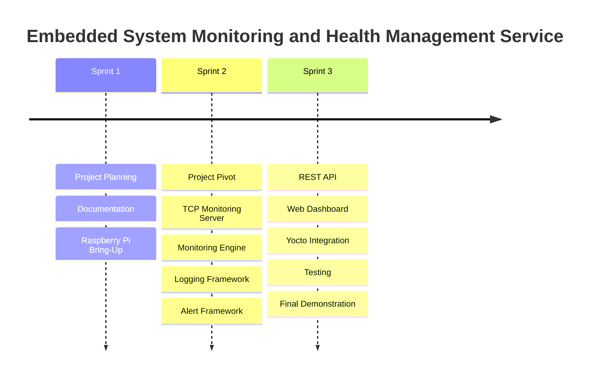

# Project Schedule

## Project Timeline

---

## Sprint 1

### Status

Completed

### Deliverables

- Repository Creation
- Project Planning
- Documentation
- Architecture Definition
- Raspberry Pi Configuration
- SSH Connectivity

---

## Sprint 2

### Status

In Progress

### Deliverables

#### Issue 14

Project Pivot

#### Issue 6

Core Monitoring Service

- CPU Monitoring
- Memory Monitoring
- Hostname Monitoring

#### Issue 7

TCP Monitoring Server

- Socket Communication
- Client Connections
- Command Processing

#### Issue 8

Extended Metrics

- Disk Usage
- Load Average
- System Uptime

#### Issue 10

Logging and Alerts

- Historical Logging
- Alert Generation

---

## Sprint 3

### Planned Deliverables

#### Issue 9

REST API

#### Issue 11

Web Dashboard

#### Issue 12

Yocto Integration

- Package Integration
- systemd Service

#### Issue 13

Final Validation

- Integration Testing
- Documentation Review
- Final Demonstration
