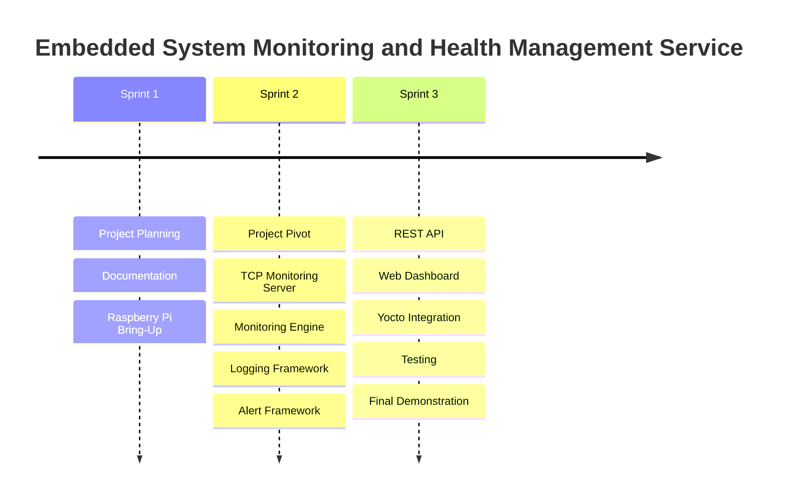

# Project Schedule

## Project Timeline

---

## Sprint 1

### Status

Completed

### Deliverables

- Repository Creation
- Project Planning
- Documentation
- Architecture Definition
- Raspberry Pi Configuration
- SSH Connectivity

---

## Sprint 2

### Status

In Progress

### Deliverables

#### Issue 14

Project Pivot

#### Issue 6

Core Monitoring Service

- CPU Monitoring
- Memory Monitoring
- Hostname Monitoring

#### Issue 7

TCP Monitoring Server

- Socket Communication
- Client Connections
- Command Processing

#### Issue 8

Extended Metrics

- Disk Usage
- Load Average
- System Uptime

#### Issue 10

Logging and Alerts

- Historical Logging
- Alert Generation

---

## Sprint 3

### Planned Deliverables

#### Issue 9

REST API

#### Issue 11

Web Dashboard

#### Issue 12

Yocto Integration

- Package Integration
- systemd Service

#### Issue 13

Final Validation

- Integration Testing
- Documentation Review
- Final Demonstration

# ***Updates to Schedule***
# Project Schedule

## Project Title

Embedded System Monitoring and Device Health Management Service

---

# Sprint 1

## Completed

### Planning and Architecture

- Project Planning
- Requirements Definition
- Architecture Definition
- Repository Setup
- Raspberry Pi Bring-Up
- Yocto Environment Preparation

### Deliverables

- Project Overview
- Project Schedule
- Requirements Specification
- Architecture Definition

---

# Sprint 2

## Completed

### Issue #6

Monitoring Service

#### Delivered

- CPU Monitoring
- Memory Monitoring
- Disk Monitoring
- Load Average Monitoring
- Uptime Monitoring
- Hostname Monitoring

---

### Issue #7

TCP Monitoring Server

#### Delivered

- TCP Server
- Client Connections
- Command Processing
- Multithreaded Client Handling

---

### Issue #9

Historical Logging and Alert Framework

#### Delivered

- Monitoring Thread
- Historical Logging
- Alert Framework
- Alert Suppression
- Recovery Notifications
- Timestamped Records

---

# Sprint 3

## Current Sprint

### Issue #14

Network Monitoring and Connectivity Alerts

#### Planned

- Network Interface Status
- IP Address Monitoring
- Connectivity Monitoring
- RX Statistics
- TX Statistics
- Network Alerts
- Network Recovery Events

---

### Issue #10

REST API Integration

#### Planned

- HTTP Service
- JSON Responses
- System Endpoint
- CPU Endpoint
- Memory Endpoint
- Disk Endpoint
- Load Endpoint
- Uptime Endpoint
- Alerts Endpoint

---

### Issue #11

Web Dashboard Development

#### Planned

- Browser Dashboard
- REST API Integration
- Alert Display
- Auto Refresh
- Device Health Visualization

---

### Final Activities

- Yocto Integration
- systemd Service Integration
- Testing
- Validation
- Final Demonstration

